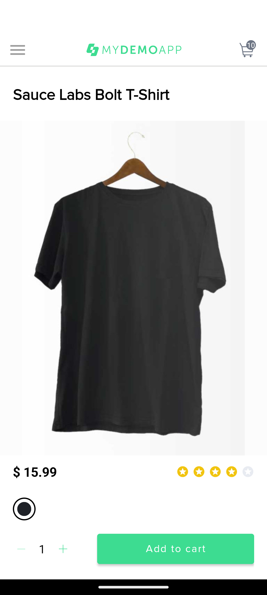

# BUG-004: กด Add To Cart สินค้า "Sauce Labs Bolt T-Shirt" แล้วแอปเพิ่ม 10 ชิ้นทุกครั้ง

| Field | Value |
| --- | --- |
| Environment | Sauce Labs My Demo App (Android) `com.saucelabs.mydemoapp.android` รุ่น 2.2.0, Android Emulator Pixel 7 API 34 |
| Account | ไม่ต้อง login |
| Severity | High |
| Priority | P1 |
| Type | Functional / ตะกร้าสินค้า |
| Test case | TC-MOB-006 ([test-cases.md](../../../mobile/appium/docs/test-cases.md)) |

## สรุป

เมื่อเพิ่มสินค้า "Sauce Labs Bolt T-Shirt" ลงตะกร้า แอปไม่ได้ใช้จำนวนที่ผู้ใช้เลือก แต่เพิ่มสินค้า 10 ชิ้นทุกครั้ง สินค้าอื่น (เช่น Sauce Labs Backpack) เพิ่มตามจำนวนที่เลือกถูกต้อง

## เงื่อนไขก่อนทดสอบ

1. ติดตั้งแอปบน emulator หรืออุปกรณ์จริง
2. ตะกร้าว่าง (เปิดแอปใหม่)

## ขั้นตอนการทำซ้ำ

1. เปิดแอป ที่หน้า Products แตะไอคอนเรียงลำดับ (มุมขวาบน) แล้วเลือก "Price - Ascending"
   (ถ้าเรียงตามชื่อ สินค้านี้จะอยู่ลำดับท้ายๆ ซึ่งแตะแล้วแอปแครชตาม [BUG-005](BUG-005-catalog-crash-on-product-tap.md))
2. แตะรูปสินค้า "Sauce Labs Bolt T-Shirt" (ตัวที่ไม่มีสีในวงเล็บ ลำดับที่ 3) เพื่อเปิดหน้ารายละเอียด
3. ไม่ปรับจำนวน (ค่าเริ่มต้นแสดง 1)
4. แตะปุ่ม "Add To Cart"
5. ดูตัวเลขบนไอคอนตะกร้ามุมขวาบน แล้วเปิดหน้า My Cart

## ผลที่คาดหวัง

- Badge บนไอคอนตะกร้าแสดง `1`
- หน้า My Cart แสดง Bolt T-Shirt จำนวน 1 ชิ้น ราคารวม `$ 15.99`

## ผลที่เกิดขึ้นจริง

- Badge แสดง `10`
- หน้า My Cart แสดงจำนวน 10 ชิ้น ราคารวมสูงกว่าที่ผู้ใช้ตั้งใจซื้อ 10 เท่า

## หลักฐาน

- Screenshot จากการรัน Maestro (TC-MOB-006) บน Android Emulator API 34: จำนวนที่เลือกคือ 1 แต่ badge ตะกร้าแสดง 10

  

- ผลจาก Robot Framework: `The text of element 'id=com.saucelabs.mydemoapp.android:id/cartTV' should have been '1' but in fact it was '10'.`
- Source code ของแอป (`ProductDetailFragment.addToCart`) บังคับค่า `number = 10` เมื่อชื่อสินค้าเท่ากับ "Sauce Labs Bolt T-Shirt" พร้อม comment ว่าเป็นบั๊กที่ใส่ไว้สำหรับเดโม

## ผลกระทบและความเสี่ยง

ผู้ใช้อาจสั่งซื้อเกินจำนวนโดยไม่รู้ตัว ทำให้ยอดชำระผิดและเกิดการคืนสินค้า/ขอเงินคืน บั๊กเกิดเฉพาะสินค้าตัวเดียว จึงหลุดจากการทดสอบที่สุ่มเลือกแค่สินค้าตัวแรกได้ง่าย

## Automation ที่ยืนยันบั๊ก

| เครื่องมือ | ไฟล์ | การจัดการ |
| --- | --- | --- |
| pytest | `mobile/appium/tests/test_known_defects.py` | `xfail(strict=True)` |
| Robot Framework | `mobile/appium/tests/known_defects.robot` | keyword `Known Defect Check` (SKIP เฉพาะขั้นตรวจผล) |
| Maestro | `mobile/maestro/flows/known_defects/tc_mob_006_bolt_tshirt_quantity.yaml` | รันแยกจากชุดหลัก |

เมื่อบั๊กถูกแก้ ให้ถอด `xfail` และ `Known Defect Check` ออก แล้วย้าย flow Maestro เข้าชุดหลัก
